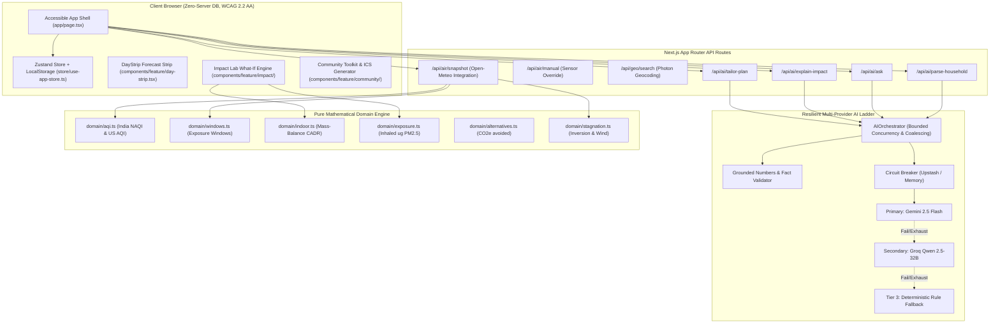
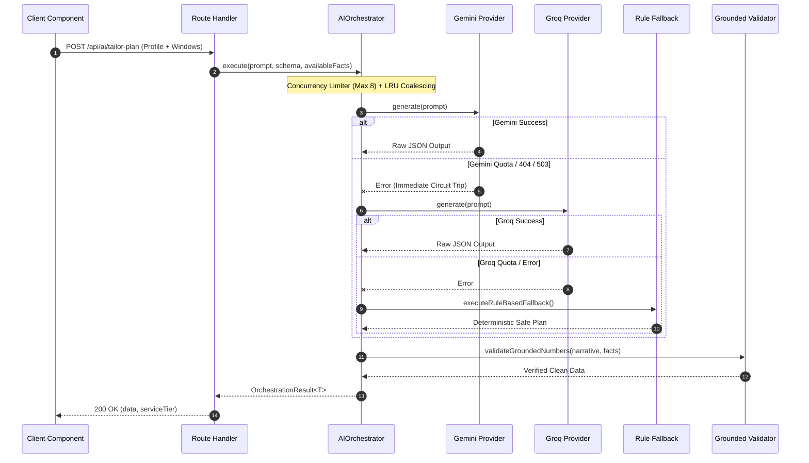

# Clearday Architecture Specification

> GenAI assistant for families and communities facing severe winter smog and urban air pollution.

---

## 1. System Topology & Architectural Principles

Clearday is built upon the **Rules first, AI second** doctrine. Safety-critical guidance (emergency detection, AQI computation, indoor CADR calculation, exposure windows, emissions reductions) executes deterministically in pure TypeScript with mathematical guarantees. The Generative AI layer acts strictly as a personalized translator, summarizer, and explanatory synthesizer bounded by a strict grounded-numbers validator.

---

## 2. Multi-Provider AI Fallback Matrix

---

## 3. Data Flow & Security Perimeter

1. **Client Isolation**: User personal coordinates, dwelling vulnerabilities, and family health categories are saved solely to browser `localStorage` under `clearday_storage_v1`. No database, no user tracking, no session cookies.
2. **Minimal Upstream Payload**: Upstream AI requests receive only coarse location (`"Delhi"`), aggregated hourly air indices, and anonymous health band flags (`"has_asthma_elderly"`).
3. **Emergency Red-Flag Interception**: If user prompt or questions match red-flag clinical conditions (chest tightness, blue lips, severe dyspnea), the system aborts AI calls and returns immediate clinical emergency hospital routing (`kb_symptoms_urgent_care`).
4. **Content Security Policy**: Strict CSP (`default-src 'self'`, `frame-ancestors 'none'`, etc.) enforced on all responses via `next.config.mjs`.
