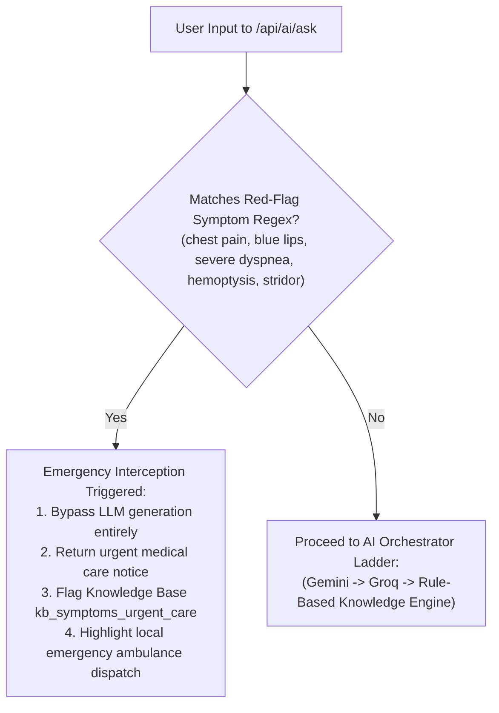

# Clearday Clinical & Air Safety Framework

> Operational protocols, non-medical boundaries, and clinical red-flag handling.

---

## 1. Non-Medical Advisory Boundary

Clearday is explicitly designed as an **environmental exposure management tool**, not a diagnostic medical device:
- **No Diagnostics**: The system never attempts to diagnose asthma, COPD, bronchitis, or cardiovascular events.
- **No Prescription / Medication Adjustments**: Clearday never advises altering dosages of inhalers, corticosteroids, or bronchodilators.
- **No Unproven Remedies**: Explicitly bans ozone generators, unverified herbal remedies, jaggery/herbal tea detox claims, or indoor combustion recommendations.

---

## 2. Red-Flag Symptom Interception Protocol

Any user query submitted via `POST /api/ai/ask` is evaluated against a clinical red-flag regular expression before model dispatch.

### RegEx Trigger Keywords
- `chest pain`, `chest tightness`, `crushing chest pressure`
- `blue lips`, `cyanosis`, `gray face`
- `stridor`, `gasping`, `unable to speak in full sentences`
- `coughing blood`, `hemoptysis`
- `infant lethargy`, `infant nasal flaring`, `grunting breath`

---

## 3. Computational Grounding Guardrails

Generative models frequently suffer from "hallucinated numerals" when generating health advice. Clearday enforces a **zero-unverified-numbers policy**:

1. **Fact Registry**: Every calculated exposure window, baseline PM2.5, inhaled dose, and ACH value is tagged with a unique string ID (e.g., `fact_current_pm25:240`).
2. **Post-Generation Fact Matching**: `services/ai/validator.ts` extracts all numerals and percentages from the AI output narrative.
3. **Verification**: If any number in the text does not correspond to an authorized fact ID or safe whitelisted metric (such as N95, 24h, PM2.5), the orchestrator triggers an automatic repair step or rejects the output in favor of the vetted rule-based narrative.
